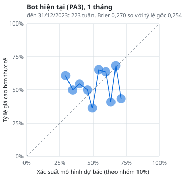
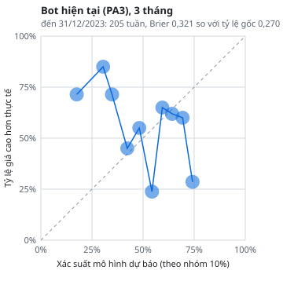
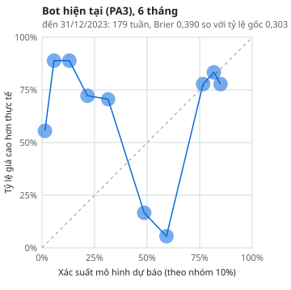
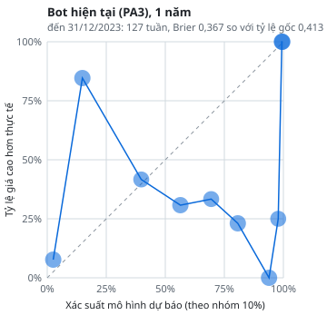
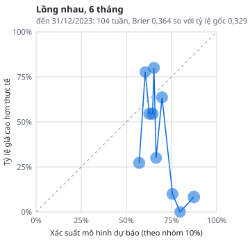
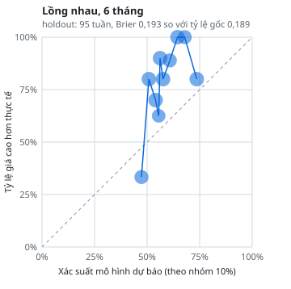

# Phụ lục báo cáo bot BTC (bản xây lại)

Mọi bảng đọc từ `data/results` và `experiments/`. Quay lại [báo cáo chính](BAO_CAO.md).

## A. Danh sách mọi cấu hình đã thử

### A1. Đăng ký trước (`config/candidates.yaml`)

| Bộ | Chỉ số | Lý do kinh tế |
|---|---|---|
| S1 | MVRV, Giá / MA 200 tuần | Giá so với giá vốn on-chain cộng xu hướng 4 năm; các đáy chu kỳ trước nằm quanh MA 200 tuần và MVRV dưới 1. |
| S2 | MVRV, Pi Cycle (tỉ số MA 111/2×MA 350) | Lõi của bot hiện tại (PA1): định giá on-chain cộng chu kỳ trung bình 111/350 ngày. |
| S3 | MVRV, Puell Multiple | Định giá cộng áp lực thợ đào: doanh thu phát hành thấp (thợ đào đầu hàng) thường trùng vùng đáy. |
| S4 | MVRV, Độ lệch so với MA 20 tuần | Định giá cộng tâm lý đo bằng giá so với MA 20 tuần (giống Fear & Greed 0,89, có lịch sử từ 2010). |
| S5 | MVRV, Fear & Greed | Như S4 nhưng dùng Fear & Greed thật (chỉ có phân vị từ 02/2020, ít dữ liệu). |
| S6 | Giá / MA 200 tuần, RSI 14 tuần | Xu hướng dài hạn cộng bán quá đà trên khung tuần. |
| S7 | Giảm từ đỉnh, Puell Multiple, Độ lệch so với MA 20 tuần | Điều kiện đầu hàng: giá giảm sâu từ đỉnh, thợ đào căng thẳng, tâm lý sợ hãi. |
| S8 | Pi Cycle (tỉ số MA 111/2×MA 350), MVRV, Fear & Greed | Bộ bot đang dùng (PA3), để so trực tiếp. |

- Mỗi bộ × λ ∈ {0.3, 1, 3} × kỳ hạn mục tiêu 26 tuần = 24 cấu hình cố định; cộng mô hình lồng nhau (vòng trong chọn bộ và λ), 2 quy tắc 1 chỉ số. Học lại mỗi 13 tuần, tối thiểu 104 tuần, vòng trong 52 tuần.
- Khung: Phải mua từ 80, Cân nhắc mua từ 60, vùng trễ 5 (cố định, không dò). Hệ số: 1 + 2 × cận khoảng tin cậy, giới hạn [0.5, 1.5], cần ≥ 3 đợt.
- Bên bán: phân vị ≥ 0.95 trong 4 năm, 4 nhóm, kích hoạt [1, 3] nhóm, bán 10%, 20%, 30%.
- Kịch bản giá: 10 mức × [1, 2, 4] tuần. Kế hoạch giải ngân: [1, 4, 13, 26, 52] tuần.

### A2. Kết quả từng cấu hình

| Cấu hình | Đến 2023: từ, số tuần, IC 26 tuần, lợi thế (KTC), p IC / p lợi thế (hiệu chỉnh) | Holdout: số tuần, IC, lợi thế, p IC / p lợi thế (hiệu chỉnh) |
|---|---|---|
| Lồng nhau | 13/02/2022, 59, -0,11, -8,6% (-16,3% đến +3,4%), 1,000 / 1,000 | IC 0,17, lợi thế -0,3%, 1,000 / 1,000 |
| S1/λ0.3 | 03/05/2020, 191, -0,03, -4,0% (-22,3% đến +5,0%), 1,000 / 1,000 | IC 0,30, lợi thế +1,0%, 1,000 / 0,762 |
| S1/λ1 | 03/05/2020, 191, -0,04, -4,1% (-22,3% đến +4,9%), 1,000 / 1,000 | IC 0,30, lợi thế +1,0%, 1,000 / 0,762 |
| S1/λ3 | 03/05/2020, 191, -0,04, -4,1% (-22,5% đến +4,9%), 1,000 / 1,000 | IC 0,30, lợi thế +1,0%, 1,000 / 0,762 |
| S2/λ0.3 | 13/09/2020, 172, -0,44, -1,3% (-5,0% đến +0,9%), 1,000 / 1,000 | IC -0,41, lợi thế -0,5%, 1,000 / 1,000 |
| S2/λ1 | 13/09/2020, 172, -0,44, -1,3% (-5,1% đến +1,0%), 1,000 / 1,000 | IC -0,41, lợi thế -0,5%, 1,000 / 1,000 |
| S2/λ3 | 13/09/2020, 172, -0,44, -1,4% (-5,2% đến +1,0%), 1,000 / 1,000 | IC -0,41, lợi thế -0,5%, 1,000 / 1,000 |
| S3/λ0.3 | 24/10/2021, 114, -0,35, -6,1% (-12,0% đến +8,7%), 1,000 / 1,000 | IC -0,38, lợi thế -1,5%, 1,000 / 1,000 |
| S3/λ1 | 24/10/2021, 114, -0,35, -6,1% (-12,1% đến +8,8%), 1,000 / 1,000 | IC -0,38, lợi thế -1,5%, 1,000 / 1,000 |
| S3/λ3 | 24/10/2021, 114, -0,35, -6,2% (-12,1% đến +8,8%), 1,000 / 1,000 | IC -0,39, lợi thế -1,5%, 1,000 / 1,000 |
| S4/λ0.3 | dưới 60 tuần ngoài mẫu, không chấm | IC -0,54, lợi thế 0,0%, 1,000 / 1,000 |
| S4/λ1 | dưới 60 tuần ngoài mẫu, không chấm | IC -0,54, lợi thế 0,0%, 1,000 / 1,000 |
| S4/λ3 | dưới 60 tuần ngoài mẫu, không chấm | IC -0,54, lợi thế 0,0%, 1,000 / 1,000 |
| S5/λ0.3 | dưới 60 tuần ngoài mẫu, không chấm | IC -0,27, lợi thế -2,7%, 1,000 / 1,000 |
| S5/λ1 | dưới 60 tuần ngoài mẫu, không chấm | IC -0,27, lợi thế -2,7%, 1,000 / 1,000 |
| S5/λ3 | dưới 60 tuần ngoài mẫu, không chấm | IC -0,27, lợi thế -2,8%, 1,000 / 1,000 |
| S6/λ0.3 | 03/05/2020, 191, -0,03, -4,0% (-22,3% đến +5,0%), 1,000 / 1,000 | IC 0,30, lợi thế +1,0%, 1,000 / 0,762 |
| S6/λ1 | 03/05/2020, 191, -0,04, -4,1% (-22,3% đến +4,9%), 1,000 / 1,000 | IC 0,30, lợi thế +1,0%, 1,000 / 0,762 |
| S6/λ3 | 03/05/2020, 191, -0,04, -4,1% (-22,5% đến +4,9%), 1,000 / 1,000 | IC 0,30, lợi thế +1,0%, 1,000 / 0,762 |
| S7/λ0.3 | 29/01/2017, 166, -0,42, -0,7% (-10,1% đến +0,7%), 1,000 / 1,000 | IC -0,43, lợi thế -0,3%, 1,000 / 1,000 |
| S7/λ1 | 29/01/2017, 166, -0,42, -0,7% (-10,1% đến +0,7%), 1,000 / 1,000 | IC -0,43, lợi thế -0,3%, 1,000 / 1,000 |
| S7/λ3 | 29/01/2017, 166, -0,43, -0,7% (-10,1% đến +0,7%), 1,000 / 1,000 | IC -0,43, lợi thế -0,3%, 1,000 / 1,000 |
| S8/λ0.3 | dưới 60 tuần ngoài mẫu, không chấm | IC -0,27, lợi thế -2,7%, 1,000 / 1,000 |
| S8/λ1 | dưới 60 tuần ngoài mẫu, không chấm | IC -0,27, lợi thế -2,7%, 1,000 / 1,000 |
| S8/λ3 | dưới 60 tuần ngoài mẫu, không chấm | IC -0,27, lợi thế -2,8%, 1,000 / 1,000 |
| Quy tắc Giá/MA 200 tuần | 07/05/2017, 347, 0,28, -3,7% (-9,8% đến +1,3%), 0,943 / 1,000 | IC 0,50, lợi thế +2,7%, 0,904 / 0,001 |
| Quy tắc MVRV | 07/07/2013, 547, -0,05, -6,1% (-25,9% đến +3,3%), 1,000 / 1,000 | IC 0,15, lợi thế +0,8%, 1,000 / 1,000 |

### A3. Giai đoạn nâng cấp trước khi xây lại (`experiments/registry.csv`, 135 lần thử)

Các lần thử này được tính vào hiệu chỉnh kiểm định bội của giai đoạn đó; chi tiết tham số và kết quả nằm trong file CSV.

| Ngày | Giai đoạn | Tên | Chỉ số |
|---|---|---|---|
| 2026-10-28 | benchmark | bot_hien_tai:auto | auto |
| 2026-10-28 | benchmark | bot_hien_tai:pa3 | pa3 |
| 2026-10-28 | benchmark | bot_hien_tai:pa1 | pa1 |
| 2026-10-28 | benchmark | bot_hien_tai:pa2 | pa2 |
| 2026-10-28 | benchmark | bot_hien_tai:pa4 | pa4 |
| 2026-10-28 | benchmark | bot_hien_tai:pa5 | pa5 |
| 2026-10-28 | benchmark | bot_hien_tai:all | all |
| 2026-10-28 | phase4 | A1:mvrv | mvrv |
| 2026-10-28 | phase4 | A1:mvrv_z | mvrv_z |
| 2026-10-28 | phase4 | A1:pi_ratio | pi_ratio |
| 2026-10-28 | phase4 | A1:p_200wma | p_200wma |
| 2026-10-28 | phase4 | A1:mayer | mayer |
| 2026-10-28 | phase4 | A1:puell | puell |
| 2026-10-28 | phase4 | A1:dd_ath | dd_ath |
| 2026-10-28 | phase4 | A1:hash_ribbon_buy | hash_ribbon_buy |
| 2026-10-28 | phase4 | A1:hash_ribbon_buy+mvrv | hash_ribbon_buy+mvrv |
| 2026-10-28 | phase4 | A1:hash_ribbon_buy+mvrv_z | hash_ribbon_buy+mvrv_z |
| 2026-10-28 | phase4 | A1:hash_ribbon_buy+pi_ratio | hash_ribbon_buy+pi_ratio |
| 2026-10-28 | phase4 | A1:hash_ribbon_buy+p_200wma | hash_ribbon_buy+p_200wma |
| 2026-10-28 | phase4 | A1:hash_ribbon_buy+mayer | hash_ribbon_buy+mayer |
| 2026-10-28 | phase4 | A1:hash_ribbon_buy+puell | hash_ribbon_buy+puell |
| 2026-10-28 | phase4 | A1:hash_ribbon_buy+dd_ath | hash_ribbon_buy+dd_ath |
| 2026-10-28 | phase4 | A2:ridge:hash_ribbon_buy | hash_ribbon_buy |
| 2026-10-28 | phase4 | A:final:hash_ribbon_buy | hash_ribbon_buy |
| 2026-10-28 | phase4 | A1:T0:mvrv | mvrv |
| 2026-10-28 | phase4 | A1:T0:mvrv_z | mvrv_z |
| 2026-10-28 | phase4 | A1:T0:pi_ratio | pi_ratio |
| 2026-10-28 | phase4 | A1:T0:p_200wma | p_200wma |
| 2026-10-28 | phase4 | A1:T0:mayer | mayer |
| 2026-10-28 | phase4 | A1:T0:puell | puell |
| 2026-10-28 | phase4 | A1:T0:dd_ath | dd_ath |
| 2026-10-28 | phase4 | A1:T0:hash_ribbon_buy | hash_ribbon_buy |
| 2026-10-28 | phase4 | A1:T0:hash_ribbon_buy+mvrv | hash_ribbon_buy+mvrv |
| 2026-10-28 | phase4 | A1:T0:hash_ribbon_buy+mvrv_z | hash_ribbon_buy+mvrv_z |
| 2026-10-28 | phase4 | A1:T0:hash_ribbon_buy+pi_ratio | hash_ribbon_buy+pi_ratio |
| 2026-10-28 | phase4 | A1:T0:hash_ribbon_buy+p_200wma | hash_ribbon_buy+p_200wma |
| 2026-10-28 | phase4 | A1:T0:hash_ribbon_buy+mayer | hash_ribbon_buy+mayer |
| 2026-10-28 | phase4 | A1:T0:hash_ribbon_buy+puell | hash_ribbon_buy+puell |
| 2026-10-28 | phase4 | A1:T0:hash_ribbon_buy+dd_ath | hash_ribbon_buy+dd_ath |
| 2026-10-28 | phase4 | A1:T1:mvrv | mvrv |
| 2026-10-28 | phase4 | A1:T1:mvrv_z | mvrv_z |
| 2026-10-28 | phase4 | A1:T1:pi_ratio | pi_ratio |
| 2026-10-28 | phase4 | A1:T1:p_200wma | p_200wma |
| 2026-10-28 | phase4 | A1:T1:mayer | mayer |
| 2026-10-28 | phase4 | A1:T1:puell | puell |
| 2026-10-28 | phase4 | A1:T1:dd_ath | dd_ath |
| 2026-10-28 | phase4 | A1:T1:hash_ribbon_buy | hash_ribbon_buy |
| 2026-10-28 | phase4 | A1:T1:hash_ribbon_buy+mvrv | hash_ribbon_buy+mvrv |
| 2026-10-28 | phase4 | A1:T1:hash_ribbon_buy+mvrv_z | hash_ribbon_buy+mvrv_z |
| 2026-10-28 | phase4 | A1:T1:hash_ribbon_buy+pi_ratio | hash_ribbon_buy+pi_ratio |
| 2026-10-28 | phase4 | A1:T1:hash_ribbon_buy+p_200wma | hash_ribbon_buy+p_200wma |
| 2026-10-28 | phase4 | A1:T1:hash_ribbon_buy+mayer | hash_ribbon_buy+mayer |
| 2026-10-28 | phase4 | A1:T1:hash_ribbon_buy+puell | hash_ribbon_buy+puell |
| 2026-10-28 | phase4 | A1:T1:hash_ribbon_buy+dd_ath | hash_ribbon_buy+dd_ath |
| 2026-10-28 | phase4 | A1:T2:mvrv | mvrv |
| 2026-10-28 | phase4 | A1:T2:mvrv_z | mvrv_z |
| 2026-10-28 | phase4 | A1:T2:pi_ratio | pi_ratio |
| 2026-10-28 | phase4 | A1:T2:p_200wma | p_200wma |
| 2026-10-28 | phase4 | A1:T2:mayer | mayer |
| 2026-10-28 | phase4 | A1:T2:puell | puell |
| 2026-10-28 | phase4 | A1:T2:dd_ath | dd_ath |
| 2026-10-28 | phase4 | A1:T2:hash_ribbon_buy | hash_ribbon_buy |
| 2026-10-28 | phase4 | A1:T2:hash_ribbon_buy+mvrv | hash_ribbon_buy+mvrv |
| 2026-10-28 | phase4 | A1:T2:hash_ribbon_buy+mvrv_z | hash_ribbon_buy+mvrv_z |
| 2026-10-28 | phase4 | A1:T2:hash_ribbon_buy+pi_ratio | hash_ribbon_buy+pi_ratio |
| 2026-10-28 | phase4 | A1:T2:hash_ribbon_buy+p_200wma | hash_ribbon_buy+p_200wma |
| 2026-10-28 | phase4 | A1:T2:hash_ribbon_buy+mayer | hash_ribbon_buy+mayer |
| 2026-10-28 | phase4 | A1:T2:hash_ribbon_buy+puell | hash_ribbon_buy+puell |
| 2026-10-28 | phase4 | A1:T2:hash_ribbon_buy+dd_ath | hash_ribbon_buy+dd_ath |
| 2026-10-28 | phase4 | A2:ridge:pool | mvrv+mvrv_z+pi_ratio+p_200wma+mayer+puell+dd_ath |
| 2026-10-28 | phase4 | A:final:T1:hash_ribbon_buy | hash_ribbon_buy |
| 2026-10-28 | phase4 | A1:T0:mvrv | mvrv |
| 2026-10-28 | phase4 | A1:T0:mvrv_z | mvrv_z |
| 2026-10-28 | phase4 | A1:T0:pi_ratio | pi_ratio |
| 2026-10-28 | phase4 | A1:T0:p_200wma | p_200wma |
| 2026-10-28 | phase4 | A1:T0:mayer | mayer |
| 2026-10-28 | phase4 | A1:T0:puell | puell |
| 2026-10-28 | phase4 | A1:T0:dd_ath | dd_ath |
| 2026-10-28 | phase4 | A1:T0:hash_ribbon_buy | hash_ribbon_buy |
| 2026-10-28 | phase4 | A1:T0:hash_ribbon_buy+mvrv | hash_ribbon_buy+mvrv |
| 2026-10-28 | phase4 | A1:T0:hash_ribbon_buy+mvrv_z | hash_ribbon_buy+mvrv_z |
| 2026-10-28 | phase4 | A1:T0:hash_ribbon_buy+pi_ratio | hash_ribbon_buy+pi_ratio |
| 2026-10-28 | phase4 | A1:T0:hash_ribbon_buy+p_200wma | hash_ribbon_buy+p_200wma |
| 2026-10-28 | phase4 | A1:T0:hash_ribbon_buy+mayer | hash_ribbon_buy+mayer |
| 2026-10-28 | phase4 | A1:T0:hash_ribbon_buy+puell | hash_ribbon_buy+puell |
| 2026-10-28 | phase4 | A1:T0:hash_ribbon_buy+dd_ath | hash_ribbon_buy+dd_ath |
| 2026-10-28 | phase4 | A1:T1:mvrv | mvrv |
| 2026-10-28 | phase4 | A1:T1:mvrv_z | mvrv_z |
| 2026-10-28 | phase4 | A1:T1:pi_ratio | pi_ratio |
| 2026-10-28 | phase4 | A1:T1:p_200wma | p_200wma |
| 2026-10-28 | phase4 | A1:T1:mayer | mayer |
| 2026-10-28 | phase4 | A1:T1:puell | puell |
| 2026-10-28 | phase4 | A1:T1:dd_ath | dd_ath |
| 2026-10-28 | phase4 | A1:T1:hash_ribbon_buy | hash_ribbon_buy |
| 2026-10-28 | phase4 | A1:T1:pi_ratio+mvrv | pi_ratio+mvrv |
| 2026-10-28 | phase4 | A1:T1:pi_ratio+mvrv_z | pi_ratio+mvrv_z |
| 2026-10-28 | phase4 | A1:T1:pi_ratio+p_200wma | pi_ratio+p_200wma |
| 2026-10-28 | phase4 | A1:T1:pi_ratio+mayer | pi_ratio+mayer |
| 2026-10-28 | phase4 | A1:T1:pi_ratio+dd_ath | pi_ratio+dd_ath |
| 2026-10-28 | phase4 | A1:T1:pi_ratio+hash_ribbon_buy | pi_ratio+hash_ribbon_buy |
| 2026-10-28 | phase4 | A1:T1:pi_ratio+p_200wma+mayer | pi_ratio+p_200wma+mayer |
| 2026-10-28 | phase4 | A1:T1:pi_ratio+p_200wma+hash_ribbon_buy | pi_ratio+p_200wma+hash_ribbon_buy |
| 2026-10-28 | phase4 | A1:T1:pi_ratio+p_200wma+hash_ribbon_buy+mayer | pi_ratio+p_200wma+hash_ribbon_buy+mayer |
| 2026-10-28 | phase4 | A1:T2:mvrv | mvrv |
| 2026-10-28 | phase4 | A1:T2:mvrv_z | mvrv_z |
| 2026-10-28 | phase4 | A1:T2:pi_ratio | pi_ratio |
| 2026-10-28 | phase4 | A1:T2:p_200wma | p_200wma |
| 2026-10-28 | phase4 | A1:T2:mayer | mayer |
| 2026-10-28 | phase4 | A1:T2:puell | puell |
| 2026-10-28 | phase4 | A1:T2:dd_ath | dd_ath |
| 2026-10-28 | phase4 | A1:T2:hash_ribbon_buy | hash_ribbon_buy |
| 2026-10-28 | phase4 | A1:T2:puell+p_200wma | puell+p_200wma |
| 2026-10-28 | phase4 | A1:T2:puell+dd_ath | puell+dd_ath |
| 2026-10-28 | phase4 | A1:T2:puell+hash_ribbon_buy | puell+hash_ribbon_buy |
| 2026-10-28 | phase4 | A1:T2:puell+hash_ribbon_buy+p_200wma | puell+hash_ribbon_buy+p_200wma |
| 2026-10-28 | phase4 | A1:T2:puell+hash_ribbon_buy+dd_ath | puell+hash_ribbon_buy+dd_ath |
| 2026-10-28 | phase4 | A2:ridge:pool | mvrv+mvrv_z+pi_ratio+p_200wma+mayer+puell+dd_ath |
| 2026-10-28 | phase4 | A:final:T1:pi_ratio+p_200wma+hash_ribbon_buy | pi_ratio+p_200wma+hash_ribbon_buy |
| 2026-10-28 | phase4 | A3:gbm_monotone:T1 | pi_ratio+p_200wma+hash_ribbon_buy |
| 2026-10-28 | phase5 | B:base_for:funding_7d | A |
| 2026-10-28 | phase5 | B:funding_7d | A+funding_7d |
| 2026-10-28 | phase5 | B:base_for:basis_ann | A |
| 2026-10-28 | phase5 | B:basis_ann | A+basis_ann |
| 2026-10-28 | phase5 | B:base_for:stable_supply_30d | A |
| 2026-10-28 | phase5 | B:stable_supply_30d | A+stable_supply_30d |
| 2026-10-28 | phase5 | B:base_for:rsi_14w | A |
| 2026-10-28 | phase5 | B:rsi_14w | A+rsi_14w |
| 2026-10-28 | phase5 | B:base_for:rsi_14d | A |
| 2026-10-28 | phase5 | B:rsi_14d | A+rsi_14d |
| 2026-10-28 | phase5 | B:base_for:capitulation | A |
| 2026-10-28 | phase5 | C:event_delay | A+event_window |
| 2026-10-28 | phase5 | C:macro_cap | A+macro_cap |
| 2026-10-28 | phase6 | SELL:rule | rsiw_80 |
| 2026-10-28 | final | FINAL:layer_a | layer_a |
| 2026-10-28 | final | FINAL:bot_hien_tai | auto |

## B. Kết quả kiểm định hoán vị

Dịch vòng tín hiệu so với lợi nhuận, độ lệch ≥ 52 tuần, 1000 lần, cùng hạt giống cho mọi cấu hình.

### Đến 31/12/2023 (Phần C)

| Cấu hình | IC 26 tuần | p thô | p max-stat | p Holm | Lợi thế (hệ số so sánh) | p thô | p max-stat | p Holm |
|---|---|---|---|---|---|---|---|---|
| Lồng nhau | -0,113 | — | 1,000 | — | -8,6% | — | 1,000 | — |
| S1/λ0.3 | -0,035 | 0,788 | 1,000 | 1,000 | -4,0% | 0,420 | 1,000 | 1,000 |
| S1/λ1 | -0,037 | 0,788 | 1,000 | 1,000 | -4,1% | 0,420 | 1,000 | 1,000 |
| S1/λ3 | -0,042 | 0,788 | 1,000 | 1,000 | -4,1% | 0,438 | 1,000 | 1,000 |
| S2/λ0.3 | -0,437 | 1,000 | 1,000 | 1,000 | -1,3% | 1,000 | 1,000 | 1,000 |
| S2/λ1 | -0,438 | 1,000 | 1,000 | 1,000 | -1,3% | 1,000 | 1,000 | 1,000 |
| S2/λ3 | -0,443 | 1,000 | 1,000 | 1,000 | -1,4% | 1,000 | 1,000 | 1,000 |
| S3/λ0.3 | -0,351 | 1,000 | 1,000 | 1,000 | -6,1% | 1,000 | 1,000 | 1,000 |
| S3/λ1 | -0,352 | 1,000 | 1,000 | 1,000 | -6,1% | 1,000 | 1,000 | 1,000 |
| S3/λ3 | -0,355 | 1,000 | 1,000 | 1,000 | -6,2% | 1,000 | 1,000 | 1,000 |
| S6/λ0.3 | -0,035 | 0,788 | 1,000 | 1,000 | -4,0% | 0,420 | 1,000 | 1,000 |
| S6/λ1 | -0,037 | 0,788 | 1,000 | 1,000 | -4,1% | 0,420 | 1,000 | 1,000 |
| S6/λ3 | -0,042 | 0,788 | 1,000 | 1,000 | -4,1% | 0,438 | 1,000 | 1,000 |
| S7/λ0.3 | -0,421 | 1,000 | 1,000 | 1,000 | -0,7% | 0,829 | 1,000 | 1,000 |
| S7/λ1 | -0,423 | 1,000 | 1,000 | 1,000 | -0,7% | 0,829 | 1,000 | 1,000 |
| S7/λ3 | -0,426 | 1,000 | 1,000 | 1,000 | -0,7% | 0,829 | 1,000 | 1,000 |
| Quy tắc MVRV | -0,051 | 0,627 | 1,000 | 1,000 | -6,1% | 0,418 | 1,000 | 1,000 |
| Quy tắc Giá/MA 200 tuần | 0,280 | 0,195 | 0,943 | 1,000 | -3,7% | 0,700 | 1,000 | 1,000 |

### Holdout 01/01/2024 → 25/10/2026 (Phần I)

| Cấu hình | IC 26 tuần | p thô | p max-stat | p Holm | Lợi thế (hệ số so sánh) | p thô | p max-stat | p Holm |
|---|---|---|---|---|---|---|---|---|
| Lồng nhau | 0,169 | 1,000 | 1,000 | 1,000 | -0,3% | 1,000 | 1,000 | 1,000 |
| S1/λ0.3 | 0,304 | 0,662 | 1,000 | 1,000 | +1,0% | 0,001 | 0,762 | 0,024 |
| S1/λ1 | 0,303 | 0,662 | 1,000 | 1,000 | +1,0% | 0,001 | 0,762 | 0,024 |
| S1/λ3 | 0,301 | 0,662 | 1,000 | 1,000 | +1,0% | 0,001 | 0,762 | 0,024 |
| S2/λ0.3 | -0,410 | 1,000 | 1,000 | 1,000 | -0,5% | 1,000 | 1,000 | 1,000 |
| S2/λ1 | -0,411 | 1,000 | 1,000 | 1,000 | -0,5% | 1,000 | 1,000 | 1,000 |
| S2/λ3 | -0,411 | 1,000 | 1,000 | 1,000 | -0,5% | 1,000 | 1,000 | 1,000 |
| S3/λ0.3 | -0,383 | 1,000 | 1,000 | 1,000 | -1,5% | 1,000 | 1,000 | 1,000 |
| S3/λ1 | -0,383 | 1,000 | 1,000 | 1,000 | -1,5% | 1,000 | 1,000 | 1,000 |
| S3/λ3 | -0,387 | 1,000 | 1,000 | 1,000 | -1,5% | 1,000 | 1,000 | 1,000 |
| S4/λ0.3 | -0,545 | — | 1,000 | — | 0,0% | — | 1,000 | — |
| S4/λ1 | -0,545 | — | 1,000 | — | 0,0% | — | 1,000 | — |
| S4/λ3 | -0,545 | — | 1,000 | — | 0,0% | — | 1,000 | — |
| S5/λ0.3 | -0,270 | 1,000 | 1,000 | 1,000 | -2,7% | 1,000 | 1,000 | 1,000 |
| S5/λ1 | -0,270 | 1,000 | 1,000 | 1,000 | -2,7% | 1,000 | 1,000 | 1,000 |
| S5/λ3 | -0,274 | 1,000 | 1,000 | 1,000 | -2,8% | 1,000 | 1,000 | 1,000 |
| S6/λ0.3 | 0,304 | 0,662 | 1,000 | 1,000 | +1,0% | 0,001 | 0,762 | 0,024 |
| S6/λ1 | 0,303 | 0,662 | 1,000 | 1,000 | +1,0% | 0,001 | 0,762 | 0,024 |
| S6/λ3 | 0,301 | 0,662 | 1,000 | 1,000 | +1,0% | 0,001 | 0,762 | 0,024 |
| S7/λ0.3 | -0,432 | 1,000 | 1,000 | 1,000 | -0,3% | 1,000 | 1,000 | 1,000 |
| S7/λ1 | -0,432 | 1,000 | 1,000 | 1,000 | -0,3% | 1,000 | 1,000 | 1,000 |
| S7/λ3 | -0,433 | 1,000 | 1,000 | 1,000 | -0,3% | 1,000 | 1,000 | 1,000 |
| S8/λ0.3 | -0,270 | 1,000 | 1,000 | 1,000 | -2,7% | 1,000 | 1,000 | 1,000 |
| S8/λ1 | -0,270 | 1,000 | 1,000 | 1,000 | -2,7% | 1,000 | 1,000 | 1,000 |
| S8/λ3 | -0,274 | 1,000 | 1,000 | 1,000 | -2,8% | 1,000 | 1,000 | 1,000 |
| Quy tắc MVRV | 0,149 | 0,819 | 1,000 | 1,000 | +0,8% | 0,025 | 1,000 | 0,425 |
| Quy tắc Giá/MA 200 tuần | 0,500 | 0,001 | 0,904 | 0,024 | +2,7% | 0,001 | 0,001 | 0,024 |

p thô để trống (—) khi chuỗi quá ngắn để dịch vòng (cần ≥ 114 tuần); p hiệu chỉnh khi đó không có ý nghĩa.

## C. Biểu đồ hiệu chỉnh

Điểm nằm trên đường chéo nghĩa là xác suất dự báo khớp tỷ lệ thực tế. Kích thước điểm theo số tuần.

## D. Kết quả theo từng chu kỳ

### D1. Bỏ từng chu kỳ khỏi dữ liệu học (Phần C, đến 2023, λ = 1)

| Bộ | Chu kỳ để kiểm tra | Số tuần | Chỉ số còn lại | Bị bỏ do sai dấu | IC 26 tuần | Lợi thế (hệ số so sánh) |
|---|---|---|---|---|---|---|
| S1 | 28/11/2012 → 08/07/2016 | — | — | — | — | không đủ dữ liệu |
| S1 | 09/07/2016 → 10/05/2020 | 201 | p_200wma | mvrv | -0,04 | -21,3% |
| S1 | 11/05/2020 → 31/12/2023 | 190 | p_200wma | mvrv | 0,32 | +0,3% |
| S2 | 28/11/2012 → 08/07/2016 | 159 | mvrv, pi_ratio | — | -0,23 | -1,6% |
| S2 | 09/07/2016 → 10/05/2020 | 201 | mvrv | pi_ratio | -0,16 | -17,2% |
| S2 | 11/05/2020 → 31/12/2023 | 190 | pi_ratio | mvrv | 0,00 | +1,4% |
| S3 | 28/11/2012 → 08/07/2016 | 166 | puell | mvrv | -0,42 | -5,8% |
| S3 | 09/07/2016 → 10/05/2020 | 201 | mvrv | puell | -0,16 | -17,1% |
| S3 | 11/05/2020 → 31/12/2023 | 190 | — | mvrv, puell | — | mọi chỉ số sai dấu, không có mô hình |
| S4 | 28/11/2012 → 08/07/2016 | 188 | mvrv | dev_ma20w | -0,30 | -3,1% |
| S4 | 09/07/2016 → 10/05/2020 | 201 | mvrv | dev_ma20w | -0,16 | -16,3% |
| S4 | 11/05/2020 → 31/12/2023 | 190 | — | mvrv, dev_ma20w | — | mọi chỉ số sai dấu, không có mô hình |
| S5 | 28/11/2012 → 08/07/2016 | — | — | — | — | không đủ dữ liệu |
| S5 | 09/07/2016 → 10/05/2020 | — | — | — | — | không đủ dữ liệu |
| S5 | 11/05/2020 → 31/12/2023 | — | — | — | — | không đủ dữ liệu |
| S6 | 28/11/2012 → 08/07/2016 | — | — | — | — | không đủ dữ liệu |
| S6 | 09/07/2016 → 10/05/2020 | 201 | p_200wma | rsi_14w | -0,04 | -21,3% |
| S6 | 11/05/2020 → 31/12/2023 | 190 | p_200wma | rsi_14w | 0,32 | +0,3% |
| S7 | 28/11/2012 → 08/07/2016 | 166 | puell | dev_ma20w, dd_ath | -0,42 | -5,8% |
| S7 | 09/07/2016 → 10/05/2020 | 201 | dd_ath | dev_ma20w, puell | -0,30 | -24,3% |
| S7 | 11/05/2020 → 31/12/2023 | 190 | — | dd_ath, puell, dev_ma20w | — | mọi chỉ số sai dấu, không có mô hình |
| S8 | 28/11/2012 → 08/07/2016 | — | — | — | — | không đủ dữ liệu |
| S8 | 09/07/2016 → 10/05/2020 | — | — | — | — | không đủ dữ liệu |
| S8 | 11/05/2020 → 31/12/2023 | — | — | — | — | không đủ dữ liệu |

### D2. Lợi thế giá vốn theo năm (hệ số so sánh 0,5 + thứ hạng)

| Chiến lược | 2014 | 2015 | 2016 | 2017 | 2018 | 2019 | 2020 | 2021 | 2022 | 2023 |
|---|---|---|---|---|---|---|---|---|---|---|
| Lồng nhau | — | — | — | — | — | — | — | — | +1,2% | -3,5% |
| Quy tắc MVRV | +0,5% | 0,0% | -5,6% | -38,7% | +2,0% | +1,9% | -3,4% | -2,0% | +0,2% | -0,3% |
| Quy tắc Giá/MA 200 tuần | — | — | — | -31,5% | +0,8% | 0,0% | 0,0% | +0,6% | 0,0% | 0,0% |
| Bot hiện tại (PA3, Phần B) | — | — | — | — | — | — | — | -5,4% | +10,0% | -0,4% |

### D3. Bên bán theo chu kỳ (Phần I)

| Quy tắc | 2016–2020 | 2020–2024 | 2024–2026 |
|---|---|---|---|
| Bán 10% khi ≥ 1 nhóm | -16,2% (4 lần) | -5,8% (4 lần) | +1,4% (2 lần) |
| Bán 20% khi ≥ 1 nhóm | -29,5% (4 lần) | -11,4% (4 lần) | +2,6% (2 lần) |
| Bán 30% khi ≥ 1 nhóm | -40,3% (4 lần) | -16,8% (4 lần) | +3,6% (2 lần) |
| Bán 10% khi ≥ 3 nhóm | +0,6% (2 lần) | -1,1% (1 lần) | 0,0% (0 lần) |
| Bán 20% khi ≥ 3 nhóm | +1,2% (2 lần) | -2,2% (1 lần) | 0,0% (0 lần) |
| Bán 30% khi ≥ 3 nhóm | +1,7% (2 lần) | -3,3% (1 lần) | 0,0% (0 lần) |

## E. Kết quả theo chế độ Fed (Phần G, đến 2023)

Chế độ hiện tại: **tăng** từ 20/09/2026. Mỗi ô so khung với mọi tuần cùng chế độ của cùng chiến lược.

### Bot hiện tại (PA3) (cảnh báo: chế độ hiện tại dưới 3 đợt)

| Chế độ (tuần, đợt) | Kỳ hạn | Khung | Số tuần | Số đợt | Giá cao hơn | Mốc (mọi tuần) | Chênh (KTC 95%) | Wilson theo đợt | Kết luận |
|---|---|---|---|---|---|---|---|---|---|
| tăng (94, 1) | 1 tháng | Phải mua | 70 | 1 | 53% | 52% | +0,6% (-7,9% đến +10,3%) | 0%–79% | ít đợt (< 3), chưa kết luận |
| tăng (94, 1) | 1 tháng | Cân nhắc mua | 7 | 2 | 71% | 52% | +19,2% (-48,9% đến +55,6%) | 9%–91% | ít đợt (< 3), chưa kết luận |
| tăng (94, 1) | 1 tháng | Không nên mua | 13 | 2 | 38% | 52% | -13,8% (-50,0% đến +35,6%) | 9%–91% | ít đợt (< 3), chưa kết luận |
| tăng (94, 1) | 3 tháng | Phải mua | 69 | 1 | 61% | 53% | +7,8% (0,0% đến +19,9%) | 0%–79% | ít đợt (< 3), chưa kết luận |
| tăng (94, 1) | 3 tháng | Cân nhắc mua | 3 | 2 | 33% | 53% | -19,8% (-65,4% đến +49,4%) | 9%–91% | ít đợt (< 3), chưa kết luận |
| tăng (94, 1) | 3 tháng | Không nên mua | 9 | 1 | 0% | 53% | -53,1% (-76,5% đến -25,9%) | 0%–79% | ít đợt (< 3), chưa kết luận |
| tăng (94, 1) | 6 tháng | Phải mua | 57 | 1 | 74% | 62% | +11,9% (0,0% đến +23,9%) | 0%–79% | ít đợt (< 3), chưa kết luận |
| tăng (94, 1) | 6 tháng | Cân nhắc mua | 2 | 1 | 0% | 62% | -61,8% (-76,5% đến -33,8%) | 0%–79% | ít đợt (< 3), chưa kết luận |
| tăng (94, 1) | 6 tháng | Không nên mua | 9 | 1 | 0% | 62% | -61,8% (-82,4% đến -35,3%) | 0%–79% | ít đợt (< 3), chưa kết luận |
| tăng (94, 1) | 1 năm | Phải mua | 31 | 1 | 97% | 71% | +25,3% (+4,6% đến +45,5%) | 0%–79% | ít đợt (< 3), chưa kết luận |
| tăng (94, 1) | 1 năm | Cân nhắc mua | 2 | 1 | 0% | 71% | -71,4% (-88,1% đến -45,2%) | 0%–79% | ít đợt (< 3), chưa kết luận |
| tăng (94, 1) | 1 năm | Không nên mua | 9 | 1 | 0% | 71% | -71,4% (-88,9% đến -45,2%) | 0%–79% | ít đợt (< 3), chưa kết luận |
| giữ (78, 1) | 1 tháng | Phải mua | 0 | 0 | — | 62% | — | — | không có tuần |
| giữ (78, 1) | 1 tháng | Cân nhắc mua | 0 | 0 | — | 62% | — | — | không có tuần |
| giữ (78, 1) | 1 tháng | Không nên mua | 78 | 1 | 62% | 62% | 0,0% (0,0% đến 0,0%) | 21%–100% | ít đợt (< 3), chưa kết luận |
| giữ (78, 1) | 3 tháng | Phải mua | 0 | 0 | — | 55% | — | — | không có tuần |
| giữ (78, 1) | 3 tháng | Cân nhắc mua | 0 | 0 | — | 55% | — | — | không có tuần |
| giữ (78, 1) | 3 tháng | Không nên mua | 78 | 1 | 55% | 55% | 0,0% (0,0% đến 0,0%) | 21%–100% | ít đợt (< 3), chưa kết luận |
| giữ (78, 1) | 6 tháng | Phải mua | 0 | 0 | — | 45% | — | — | không có tuần |
| giữ (78, 1) | 6 tháng | Cân nhắc mua | 0 | 0 | — | 45% | — | — | không có tuần |
| giữ (78, 1) | 6 tháng | Không nên mua | 78 | 1 | 45% | 45% | 0,0% (0,0% đến 0,0%) | 21%–100% | ít đợt (< 3), chưa kết luận |
| giữ (78, 1) | 1 năm | Phải mua | 0 | 0 | — | 26% | — | — | không có tuần |
| giữ (78, 1) | 1 năm | Cân nhắc mua | 0 | 0 | — | 26% | — | — | không có tuần |
| giữ (78, 1) | 1 năm | Không nên mua | 78 | 1 | 26% | 26% | 0,0% (0,0% đến 0,0%) | 21%–100% | ít đợt (< 3), chưa kết luận |
| giảm (7, 1) | 1 tháng | Phải mua | 0 | 0 | — | 43% | — | — | không có tuần |
| giảm (7, 1) | 1 tháng | Cân nhắc mua | 0 | 0 | — | 43% | — | — | không có tuần |
| giảm (7, 1) | 1 tháng | Không nên mua | 7 | 1 | 43% | 43% | 0,0% (0,0% đến 0,0%) | 21%–100% | ít đợt (< 3), chưa kết luận |
| giảm (7, 1) | 3 tháng | Phải mua | 0 | 0 | — | 100% | — | — | không có tuần |
| giảm (7, 1) | 3 tháng | Cân nhắc mua | 0 | 0 | — | 100% | — | — | không có tuần |
| giảm (7, 1) | 3 tháng | Không nên mua | 7 | 1 | 100% | 100% | 0,0% (0,0% đến 0,0%) | 21%–100% | ít đợt (< 3), chưa kết luận |
| giảm (7, 1) | 6 tháng | Phải mua | 0 | 0 | — | 100% | — | — | không có tuần |
| giảm (7, 1) | 6 tháng | Cân nhắc mua | 0 | 0 | — | 100% | — | — | không có tuần |
| giảm (7, 1) | 6 tháng | Không nên mua | 7 | 1 | 100% | 100% | 0,0% (0,0% đến 0,0%) | 21%–100% | ít đợt (< 3), chưa kết luận |
| giảm (7, 1) | 1 năm | Phải mua | 0 | 0 | — | 100% | — | — | không có tuần |
| giảm (7, 1) | 1 năm | Cân nhắc mua | 0 | 0 | — | 100% | — | — | không có tuần |
| giảm (7, 1) | 1 năm | Không nên mua | 7 | 1 | 100% | 100% | 0,0% (0,0% đến 0,0%) | 21%–100% | ít đợt (< 3), chưa kết luận |

### Mô hình lồng nhau (cảnh báo: chế độ hiện tại dưới 3 đợt)

| Chế độ (tuần, đợt) | Kỳ hạn | Khung | Số tuần | Số đợt | Giá cao hơn | Mốc (mọi tuần) | Chênh (KTC 95%) | Wilson theo đợt | Kết luận |
|---|---|---|---|---|---|---|---|---|---|
| tăng (54, 1) | 1 tháng | Phải mua | 21 | 1 | 29% | 46% | -17,4% (-50,0% đến +5,5%) | 0%–79% | ít đợt (< 3), chưa kết luận |
| tăng (54, 1) | 1 tháng | Cân nhắc mua | 0 | 0 | — | 46% | — | — | không có tuần |
| tăng (54, 1) | 1 tháng | Không nên mua | 29 | 1 | 59% | 46% | +12,6% (-4,8% đến +34,4%) | 0%–79% | ít đợt (< 3), chưa kết luận |
| tăng (54, 1) | 3 tháng | Phải mua | 21 | 1 | 5% | 29% | -24,5% (-56,1% đến +0,8%) | 0%–79% | ít đợt (< 3), chưa kết luận |
| tăng (54, 1) | 3 tháng | Cân nhắc mua | 0 | 0 | — | 29% | — | — | không có tuần |
| tăng (54, 1) | 3 tháng | Không nên mua | 20 | 1 | 55% | 29% | +25,7% (-2,4% đến +68,3%) | 0%–79% | ít đợt (< 3), chưa kết luận |
| tăng (54, 1) | 6 tháng | Phải mua | 21 | 1 | 5% | 29% | -23,8% (-46,4% đến 0,0%) | 0%–79% | ít đợt (< 3), chưa kết luận |
| tăng (54, 1) | 6 tháng | Cân nhắc mua | 0 | 0 | — | 29% | — | — | không có tuần |
| tăng (54, 1) | 6 tháng | Không nên mua | 7 | 1 | 100% | 29% | +71,4% (+46,4% đến +92,9%) | 21%–100% | ít đợt (< 3), chưa kết luận |
| tăng (54, 1) | 1 năm | Phải mua | 2 | 1 | 50% | 50% | 0,0% (0,0% đến 0,0%) | 21%–100% | ít đợt (< 3), chưa kết luận |
| tăng (54, 1) | 1 năm | Cân nhắc mua | 0 | 0 | — | 50% | — | — | không có tuần |
| tăng (54, 1) | 1 năm | Không nên mua | 0 | 0 | — | 50% | — | — | không có tuần |
| giữ (5, 1) | 1 tháng | Phải mua | 5 | 1 | 60% | 60% | 0,0% (0,0% đến 0,0%) | 0%–79% | ít đợt (< 3), chưa kết luận |
| giữ (5, 1) | 1 tháng | Cân nhắc mua | 0 | 0 | — | 60% | — | — | không có tuần |
| giữ (5, 1) | 1 tháng | Không nên mua | 0 | 0 | — | 60% | — | — | không có tuần |
| giữ (5, 1) | 3 tháng | Phải mua | 5 | 1 | 0% | 0% | 0,0% (0,0% đến 0,0%) | 0%–79% | ít đợt (< 3), chưa kết luận |
| giữ (5, 1) | 3 tháng | Cân nhắc mua | 0 | 0 | — | 0% | — | — | không có tuần |
| giữ (5, 1) | 3 tháng | Không nên mua | 0 | 0 | — | 0% | — | — | không có tuần |
| giữ (5, 1) | 6 tháng | Phải mua | 5 | 1 | 0% | 0% | 0,0% (0,0% đến 0,0%) | 0%–79% | ít đợt (< 3), chưa kết luận |
| giữ (5, 1) | 6 tháng | Cân nhắc mua | 0 | 0 | — | 0% | — | — | không có tuần |
| giữ (5, 1) | 6 tháng | Không nên mua | 0 | 0 | — | 0% | — | — | không có tuần |
| giữ (5, 1) | 1 năm | Phải mua | 5 | 1 | 60% | 60% | 0,0% (0,0% đến 0,0%) | 0%–79% | ít đợt (< 3), chưa kết luận |
| giữ (5, 1) | 1 năm | Cân nhắc mua | 0 | 0 | — | 60% | — | — | không có tuần |
| giữ (5, 1) | 1 năm | Không nên mua | 0 | 0 | — | 60% | — | — | không có tuần |
| giảm (0) | — | — | 0 | 0 | — | — | — | — | không có tuần |

### Quy tắc MVRV

| Chế độ (tuần, đợt) | Kỳ hạn | Khung | Số tuần | Số đợt | Giá cao hơn | Mốc (mọi tuần) | Chênh (KTC 95%) | Wilson theo đợt | Kết luận |
|---|---|---|---|---|---|---|---|---|---|
| tăng (250, 3) | 1 tháng | Phải mua | 68 | 2 | 60% | 59% | +1,4% (-13,2% đến +17,2%) | 0%–66% | ít đợt (< 3), chưa kết luận |
| tăng (250, 3) | 1 tháng | Cân nhắc mua | 63 | 5 | 46% | 59% | -12,9% (-26,7% đến +2,7%) | 23%–88% | chưa có lợi thế |
| tăng (250, 3) | 1 tháng | Không nên mua | 115 | 6 | 65% | 59% | +6,3% (-2,9% đến +15,5%) | 19%–81% | chưa có lợi thế |
| tăng (250, 3) | 3 tháng | Phải mua | 68 | 2 | 65% | 61% | +3,9% (-27,9% đến +32,9%) | 0%–66% | ít đợt (< 3), chưa kết luận |
| tăng (250, 3) | 3 tháng | Cân nhắc mua | 59 | 5 | 37% | 61% | -23,5% (-53,3% đến -2,3%) | 4%–62% | **kém mốc** |
| tăng (250, 3) | 3 tháng | Không nên mua | 110 | 5 | 71% | 61% | +10,1% (-7,5% đến +25,6%) | 12%–77% | chưa có lợi thế |
| tăng (250, 3) | 6 tháng | Phải mua | 68 | 2 | 81% | 65% | +16,2% (-14,2% đến +46,0%) | 9%–91% | ít đợt (< 3), chưa kết luận |
| tăng (250, 3) | 6 tháng | Cân nhắc mua | 46 | 5 | 26% | 65% | -38,6% (-64,5% đến -14,1%) | 4%–62% | **kém mốc** |
| tăng (250, 3) | 6 tháng | Không nên mua | 110 | 5 | 71% | 65% | +6,2% (-20,3% đến +18,6%) | 23%–88% | chưa có lợi thế |
| tăng (250, 3) | 1 năm | Phải mua | 57 | 2 | 93% | 79% | +13,7% (-1,2% đến +32,8%) | 9%–91% | ít đợt (< 3), chưa kết luận |
| tăng (250, 3) | 1 năm | Cân nhắc mua | 31 | 4 | 81% | 79% | +1,4% (-82,1% đến +22,7%) | 15%–85% | chưa có lợi thế |
| tăng (250, 3) | 1 năm | Không nên mua | 110 | 5 | 72% | 79% | -7,5% (-36,8% đến +4,0%) | 38%–96% | chưa có lợi thế |
| giữ (238, 4) | 1 tháng | Phải mua | 81 | 3 | 47% | 58% | -11,5% (-26,2% đến +4,1%) | 21%–94% | chưa có lợi thế |
| giữ (238, 4) | 1 tháng | Cân nhắc mua | 19 | 5 | 53% | 58% | -5,8% (-41,2% đến +29,8%) | 23%–88% | chưa có lợi thế |
| giữ (238, 4) | 1 tháng | Không nên mua | 138 | 5 | 66% | 58% | +7,5% (-1,2% đến +17,0%) | 23%–88% | chưa có lợi thế |
| giữ (238, 4) | 3 tháng | Phải mua | 81 | 3 | 41% | 52% | -10,9% (-29,5% đến +13,7%) | 21%–94% | chưa có lợi thế |
| giữ (238, 4) | 3 tháng | Cân nhắc mua | 19 | 5 | 53% | 52% | +1,0% (-27,6% đến +28,4%) | 23%–88% | chưa có lợi thế |
| giữ (238, 4) | 3 tháng | Không nên mua | 138 | 5 | 58% | 52% | +6,3% (-6,0% đến +20,4%) | 23%–88% | chưa có lợi thế |
| giữ (238, 4) | 6 tháng | Phải mua | 81 | 3 | 36% | 51% | -15,5% (-40,2% đến +25,3%) | 21%–94% | chưa có lợi thế |
| giữ (238, 4) | 6 tháng | Cân nhắc mua | 19 | 5 | 58% | 51% | +6,6% (-35,8% đến +39,5%) | 23%–88% | chưa có lợi thế |
| giữ (238, 4) | 6 tháng | Không nên mua | 138 | 5 | 59% | 51% | +8,2% (-7,0% đến +26,8%) | 38%–96% | chưa có lợi thế |
| giữ (238, 4) | 1 năm | Phải mua | 81 | 3 | 53% | 51% | +1,8% (-24,7% đến +47,1%) | 21%–94% | chưa có lợi thế |
| giữ (238, 4) | 1 năm | Cân nhắc mua | 19 | 5 | 58% | 51% | +6,6% (-26,3% đến +36,6%) | 23%–88% | chưa có lợi thế |
| giữ (238, 4) | 1 năm | Không nên mua | 138 | 5 | 49% | 51% | -2,0% (-19,3% đến +15,8%) | 38%–96% | chưa có lợi thế |
| giảm (59, 1) | 1 tháng | Phải mua | 13 | 2 | 92% | 51% | +41,5% (+22,3% đến +63,0%) | 34%–100% | ít đợt (< 3), chưa kết luận |
| giảm (59, 1) | 1 tháng | Cân nhắc mua | 18 | 5 | 78% | 51% | +26,9% (+2,2% đến +49,2%) | 38%–96% | hơn mốc |
| giảm (59, 1) | 1 tháng | Không nên mua | 28 | 5 | 14% | 51% | -36,6% (-57,6% đến -18,4%) | 4%–62% | **kém mốc** |
| giảm (59, 1) | 3 tháng | Phải mua | 13 | 2 | 69% | 61% | +8,2% (-24,8% đến +42,4%) | 34%–100% | ít đợt (< 3), chưa kết luận |
| giảm (59, 1) | 3 tháng | Cân nhắc mua | 18 | 5 | 67% | 61% | +5,6% (-8,4% đến +19,5%) | 23%–88% | chưa có lợi thế |
| giảm (59, 1) | 3 tháng | Không nên mua | 28 | 5 | 54% | 61% | -7,4% (-24,7% đến +7,2%) | 12%–77% | chưa có lợi thế |
| giảm (59, 1) | 6 tháng | Phải mua | 13 | 2 | 100% | 75% | +25,4% (0,0% đến +50,8%) | 34%–100% | ít đợt (< 3), chưa kết luận |
| giảm (59, 1) | 6 tháng | Cân nhắc mua | 18 | 5 | 78% | 75% | +3,2% (-9,3% đến +15,8%) | 38%–96% | chưa có lợi thế |
| giảm (59, 1) | 6 tháng | Không nên mua | 28 | 5 | 61% | 75% | -13,9% (-29,4% đến 0,0%) | 23%–88% | chưa có lợi thế |
| giảm (59, 1) | 1 năm | Phải mua | 13 | 2 | 100% | 98% | +1,7% (0,0% đến +3,4%) | 34%–100% | ít đợt (< 3), chưa kết luận |
| giảm (59, 1) | 1 năm | Cân nhắc mua | 18 | 5 | 100% | 98% | +1,7% (0,0% đến +3,4%) | 57%–100% | chưa có lợi thế |
| giảm (59, 1) | 1 năm | Không nên mua | 28 | 5 | 96% | 98% | -1,9% (-3,1% đến 0,0%) | 38%–96% | chưa có lợi thế |

### Quy tắc Giá/MA 200 tuần (cảnh báo: chế độ hiện tại dưới 3 đợt)

| Chế độ (tuần, đợt) | Kỳ hạn | Khung | Số tuần | Số đợt | Giá cao hơn | Mốc (mọi tuần) | Chênh (KTC 95%) | Wilson theo đợt | Kết luận |
|---|---|---|---|---|---|---|---|---|---|
| tăng (204, 2) | 1 tháng | Phải mua | 107 | 3 | 58% | 56% | +1,9% (-8,0% đến +12,6%) | 21%–94% | chưa có lợi thế |
| tăng (204, 2) | 1 tháng | Cân nhắc mua | 48 | 6 | 44% | 56% | -12,3% (-30,9% đến +7,7%) | 19%–81% | chưa có lợi thế |
| tăng (204, 2) | 1 tháng | Không nên mua | 45 | 1 | 64% | 56% | +8,4% (-12,0% đến +27,5%) | 21%–100% | ít đợt (< 3), chưa kết luận |
| tăng (204, 2) | 3 tháng | Phải mua | 107 | 3 | 53% | 53% | -0,1% (-14,0% đến +14,7%) | 6%–79% | chưa có lợi thế |
| tăng (204, 2) | 3 tháng | Cân nhắc mua | 39 | 5 | 38% | 53% | -14,9% (-39,9% đến +5,6%) | 12%–77% | chưa có lợi thế |
| tăng (204, 2) | 3 tháng | Không nên mua | 45 | 1 | 67% | 53% | +13,3% (-26,4% đến +46,6%) | 21%–100% | ít đợt (< 3), chưa kết luận |
| tăng (204, 2) | 6 tháng | Phải mua | 101 | 2 | 58% | 56% | +2,8% (-18,8% đến +16,1%) | 0%–66% | ít đợt (< 3), chưa kết luận |
| tăng (204, 2) | 6 tháng | Cân nhắc mua | 32 | 5 | 31% | 56% | -24,4% (-57,3% đến +0,9%) | 0%–43% | chưa có lợi thế |
| tăng (204, 2) | 6 tháng | Không nên mua | 45 | 1 | 67% | 56% | +11,0% (-36,8% đến +45,5%) | 21%–100% | ít đợt (< 3), chưa kết luận |
| tăng (204, 2) | 1 năm | Phải mua | 88 | 2 | 92% | 73% | +19,0% (+4,0% đến +35,4%) | 0%–66% | ít đợt (< 3), chưa kết luận |
| tăng (204, 2) | 1 năm | Cân nhắc mua | 19 | 4 | 21% | 73% | -52,0% (-69,8% đến -35,2%) | 15%–85% | **kém mốc** |
| tăng (204, 2) | 1 năm | Không nên mua | 45 | 1 | 58% | 73% | -15,2% (-73,2% đến +15,8%) | 21%–100% | ít đợt (< 3), chưa kết luận |
| giữ (84, 2) | 1 tháng | Phải mua | 1 | 1 | 100% | 61% | +39,3% (+21,4% đến +56,0%) | 21%–100% | ít đợt (< 3), chưa kết luận |
| giữ (84, 2) | 1 tháng | Cân nhắc mua | 30 | 4 | 77% | 61% | +16,0% (-2,4% đến +36,6%) | 15%–85% | chưa có lợi thế |
| giữ (84, 2) | 1 tháng | Không nên mua | 53 | 3 | 51% | 61% | -9,8% (-25,2% đến +0,8%) | 21%–94% | chưa có lợi thế |
| giữ (84, 2) | 3 tháng | Phải mua | 1 | 1 | 0% | 51% | -51,2% (-71,4% đến -29,8%) | 0%–79% | ít đợt (< 3), chưa kết luận |
| giữ (84, 2) | 3 tháng | Cân nhắc mua | 30 | 4 | 57% | 51% | +5,5% (-11,7% đến +38,7%) | 15%–85% | chưa có lợi thế |
| giữ (84, 2) | 3 tháng | Không nên mua | 53 | 3 | 49% | 51% | -2,1% (-12,7% đến +11,2%) | 21%–94% | chưa có lợi thế |
| giữ (84, 2) | 6 tháng | Phải mua | 1 | 1 | 0% | 42% | -41,7% (-65,5% đến -17,9%) | 0%–79% | ít đợt (< 3), chưa kết luận |
| giữ (84, 2) | 6 tháng | Cân nhắc mua | 30 | 4 | 43% | 42% | +1,7% (-14,3% đến +33,8%) | 15%–85% | chưa có lợi thế |
| giữ (84, 2) | 6 tháng | Không nên mua | 53 | 3 | 42% | 42% | -0,2% (-10,5% đến +12,0%) | 6%–79% | chưa có lợi thế |
| giữ (84, 2) | 1 năm | Phải mua | 1 | 1 | 100% | 25% | +75,0% (+50,0% đến +94,0%) | 21%–100% | ít đợt (< 3), chưa kết luận |
| giữ (84, 2) | 1 năm | Cân nhắc mua | 30 | 4 | 30% | 25% | +5,0% (-11,9% đến +23,8%) | 5%–70% | chưa có lợi thế |
| giữ (84, 2) | 1 năm | Không nên mua | 53 | 3 | 21% | 25% | -4,2% (-12,7% đến +4,7%) | 6%–79% | chưa có lợi thế |
| giảm (59, 1) | 1 tháng | Phải mua | 49 | 1 | 55% | 51% | +4,3% (-0,7% đến +11,7%) | 0%–79% | ít đợt (< 3), chưa kết luận |
| giảm (59, 1) | 1 tháng | Cân nhắc mua | 10 | 2 | 30% | 51% | -20,8% (-54,2% đến +12,6%) | 9%–91% | ít đợt (< 3), chưa kết luận |
| giảm (59, 1) | 1 tháng | Không nên mua | 0 | 0 | — | 51% | — | — | không có tuần |
| giảm (59, 1) | 3 tháng | Phải mua | 49 | 1 | 59% | 61% | -1,8% (-10,7% đến +3,8%) | 0%–79% | ít đợt (< 3), chưa kết luận |
| giảm (59, 1) | 3 tháng | Cân nhắc mua | 10 | 2 | 70% | 61% | +9,0% (-52,5% đến +42,4%) | 9%–91% | ít đợt (< 3), chưa kết luận |
| giảm (59, 1) | 3 tháng | Không nên mua | 0 | 0 | — | 61% | — | — | không có tuần |
| giảm (59, 1) | 6 tháng | Phải mua | 49 | 1 | 76% | 75% | +0,9% (-7,3% đến +5,1%) | 0%–79% | ít đợt (< 3), chưa kết luận |
| giảm (59, 1) | 6 tháng | Cân nhắc mua | 10 | 2 | 70% | 75% | -4,6% (-62,7% đến +22,0%) | 9%–91% | ít đợt (< 3), chưa kết luận |
| giảm (59, 1) | 6 tháng | Không nên mua | 0 | 0 | — | 75% | — | — | không có tuần |
| giảm (59, 1) | 1 năm | Phải mua | 49 | 1 | 100% | 98% | +1,7% (0,0% đến +3,4%) | 21%–100% | ít đợt (< 3), chưa kết luận |
| giảm (59, 1) | 1 năm | Cân nhắc mua | 10 | 2 | 90% | 98% | -8,3% (-18,3% đến 0,0%) | 9%–91% | ít đợt (< 3), chưa kết luận |
| giảm (59, 1) | 1 năm | Không nên mua | 0 | 0 | — | 98% | — | — | không có tuần |
